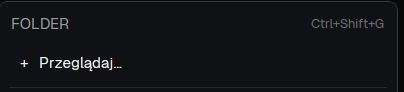

# Folder Picker

Szybki wybór folderu roboczego w Herdrze. Okno z listą folderów z otwartych przestrzeni i ostatnio użytych oraz przycisk natywnego wyboru folderu. Wybranie folderu zakłada nową przestrzeń (`space.new`) w tym katalogu. Ctrl+Shift+G otwiera mod i od razu wywołuje wybór folderu.

## What you see

- Okno modu (overlay 320×380) albo panel po prawej (`place: right`, 240 px).
- Nagłówek „FOLDER", po prawej podpowiedź „Ctrl+Shift+G".
- Wiersz „+ Przeglądaj…" — natywny wybór folderu.
- Separator i lista: nazwa przestrzeni lub folderu (jaśniejsza), pełna ścieżka (ciemniejsza, 10 px), opcjonalnie nazwa maszyny po prawej.
- Kolory z `theme()`: `chrome` tło, `selected` hover przycisku, `raised` hover wiersza, `border` separator, `dim`/`muted` tekst pomocniczy, `foreground` nazwa.

## How it behaves

- Kliknięcie wiersza zapamiętuje folder i wykonuje `run("space.new", { folder, machine })`.
- „Przeglądaj…" wywołuje `pickFolder({ prompt: "Wybierz folder roboczy" })`. Anulowanie nic nie zmienia; wybór tworzy przestrzeń lokalną (`machine: ""`).
- Lista: najpierw foldery z `spaces()` (pomijane puste, deduplikacja po `machine + folder`), potem `shared("folder-picker.recent")` — maks. 6 wpisów, najświeższy pierwszy.
- Foldery ze zdalnych maszyn są oznaczone nazwą maszyny i na niej zakładane; wybór z okna systemowego zawsze tworzy przestrzeń lokalną.
- Po wyborze okno overlay zamyka się przez `closeOverlay(props().overlay)`; w zadokowanym panelu mod zostaje.
- Skrót Ctrl+Shift+G to `mod.open:folder-picker`, ponieważ Herdr nie przyjmuje komend modu jako akcji klawisza w `keys.json`. Otwarcie modu jako overlay wywołuje `browse()` w `init()`.

## Built from

- `mods/folder-picker/mod.json`: `place: "right"`, `size: 240`, `overlay: { width: 320, height: 380 }`.
- `main.js`: klasa rozszerzająca `View`, funkcje `recent`, `short`, `remember`, `start`, `browse`, `rows`, `render`; `init()` z `checking()` i `props().overlay`.
- `herdr`: `spaces`, `shared`, `setShared`, `pickFolder`, `run`, `closeOverlay`, `props`, `theme`, `checking`.
- `gpui-kit`: `div`; `gpui-base`: `v_flex`, `h_flex`.
- `keys.json`: `global.ctrl-shift-g` → `mod.open:folder-picker`.
- Komenda aplikacji: `space.new`.

## Watch out

- Wbudowane layouty i mody Herdra są odtwarzane przy starcie — nazwa `folder-picker` jest unikalna, więc pliki przetrwają.
- Nowy mod dockuje się do aktualnego layoutu przy pierwszym zobaczeniu; jeśli panel nie jest widoczny, skrót i tak otwiera okno.
- `pickFolder` działa tylko lokalnie. Dla folderu na zdalnej maszynie użyj wiersza z listy — zachowuje `machine`.
- Ostatnie foldery siedzą w `shared.json` pod kluczem `folder-picker.recent`, nie w pliku modu. `herdr-app check` używa pustego shared state i nie zapisuje tego pliku.
- Bez `RECIPE.md` i `preview.png` herdr.dev nie pokaże modu.

## Done when

- `herdr-app check <folder modu>` przechodzi, nie ma `main.error`, a `herdr-app status` pokazuje `errors: []`.
- Ctrl+Shift+G otwiera okno i natywny wybór folderu.
- Wybór folderu tworzy nową przestrzeń, której `folder` wskazuje wybrany katalog.
- Po ponownym otwarciu modu wybrany folder jest na liście.
