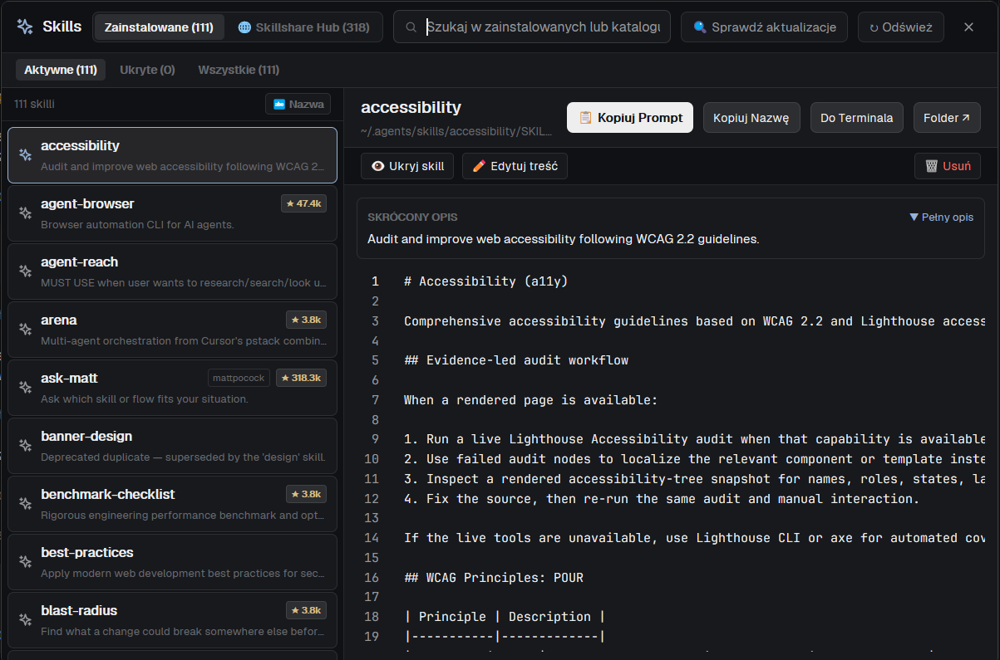

# Skill Hub

Panel zarządzania skillami agentów w Herdrze: zainstalowane skille (z `~/.agents/skills`) oraz katalog Skillshare Hub. Pozwala przeglądać treść `SKILL.md`, kopiować prompt/nazwę/polecenie instalacji, ukrywać i usuwać skille, sprawdzać aktualizacje i instalować nowe z katalogu. W modzie spakowano rozbudowany katalog hubu — dzięki temu zakładka „Skillshare Hub" działa też na komputerze, który nie ma jeszcze lokalnego katalogu. Otwiera się skrótem Ctrl+Shift+H.

## What you see

- Okno dialogowe 960×640 (`mod.json`: `place: "none"`, `focusable: true`, `overlay.kind: "dialog"`).
- Górny pasek: tytuł „Skills", zakładki „Zainstalowane" i „Skillshare Hub", pole wyszukiwania, „Sprawdź aktualizacje", „Odśwież", X.
- Podzakładki „Aktywne", „Ukryte", „Wszystkie" z licznikami.
- Lewa kolumna: lista skilli z ikoną, nazwą, skróconym opisem i liczbą gwiazdek (np. `★ 47.4k`). Sortowanie po nazwie lub gwiazdkach.
- Prawa kolumna: nagłówek skillu, przyciski „Kopiuj Prompt", „Kopiuj Nazwę", „Do Terminala", „Folder", oraz „Ukryj skill", „Edytuj treść", „Usuń".
- Dalej „SKRÓCONY OPIS" / „Pełny opis" i numerowany widok treści `SKILL.md` z podświetlaniem składni.
- W zakładce Hub: kategorie (`Wszystkie`, `pstack`, `Cloudflare`, `Workflow`, `AI`, `Frontend`, `DevOps`, `Backend`, `Testing`, `Marketing`), sortowanie po gwiazdkach/nazwie, strony po 60 wyników, statystyki GitHub (gwiazdki, forki, issue, data pusha, licencja).
- Kolory z `theme()`; tytuły i dane liczbowe używają kolorów ANSI (`ansi3` itd.).

## How it behaves

- Wybór skillu pokazuje jego opis i treść `SKILL.md`; „Pełny opis" rozwija długi opis.
- „Kopiuj Prompt" kopiuje treść do schowka, „Kopiuj Nazwę" — nazwę, „Do Terminala" — wkleja polecenie do terminala, „Folder" otwiera katalog skillu.
- „Ukryj skill" / „Przywróć" zapisuje listę w `shared("skills.hidden")` (z fallbackiem do `localStorage`); „Edytuj treść" zapisuje plik przez `writeTextFile`; „Usuń" usuwa katalog.
- „Sprawdź aktualizacje" sprawdza źródła Git i lockfile; powiadomienia `notify()` w języku polskim.
- Zakładka Hub ładuje `~/.agents/skills/skillshare-hub/skillshare-hub.json`; jeśli pliku nie ma albo lista jest pusta, używa `mods/skill-hub/skillshare-hub.json`. Statystyki z `github-stats.json` w tym samym katalogu, z fallbackiem do `mods/skill-hub/github-stats.json`.
- Zakładka „Zainstalowane" skanuje `~/.agents/skills` przez `exec`. Bez lokalnych skilli jest pusta — mod nie dołącza listy zainstalowanych skilli.
- Instalacja z Hubu buduje `npx -y skills add <owner>/<repo> --skill <path> -g -y` i uruchamia ją przez `exec("cmd.exe", ["/c", cmd])`; „Kopiuj polecenie" daje wersję bez `-y`.
- „Otwórz repozytorium" używa `start <url>` na Windows i `open` / `xdg-open` alt.
- Wyszukiwanie filtruje zainstalowane i katalog Hub; przełączanie zakładek resetuje zaznaczenie i pozycję listy.

## Built from

- `mods/skill-hub/mod.json`: `place: "none"`, `focusable: true`, `overlay: { kind: "dialog", width: 960, height: 640 }`.
- `main.js` (~2 843 linii): klasa `View`; `init()` ładuje dane, `close()` sprząta; funkcje m.in. `parseSkill`, `getShortDescription`, `parseDiffLines`, `load`, `filteredHubSkills`, `installHubSkill`, `openHubUrl`, `copyInstallCommand`.
- `herdr`: `home`, `readTextFile`, `writeTextFile`, `exec`, `hc`, `notify`, `focused`, `window`, `theme`, `settings`, `props`, `closeOverlay`, `shared`, `setShared`.
- `gpui-kit`: `View`, `div`, `svg`; `gpui-base`: `v_flex`, `h_flex`, `Input`, `InputState`, `Editor`, `EditorState`.
- Zasoby w `mods/skill-hub/`: `skills.svg` (5 odwołań), `github-stats.json` (fallback statystyk), `skillshare-hub.json` (91 KB, katalog z wpisami i źródłami do pobrania).
- Funkcje `getShortDescription`/`parseSkill` używane do opisów lokalnych skilli.
- `keys.json`: `global.ctrl-shift-h` → `mod.open:skill-hub`. `Ctrl+Shift+S` jest zajęty przez domyślny `mod.open:skills`, więc użyty został wolny `Ctrl+Shift+H`.

## Watch out

- Mod nazywa się `skill-hub`, **nie** `skills` — `skills` to wbudowany mod Herdra i zostałby nadpisany przy starcie. W kodzie poprawiono 5 ścieżek `mods/skills/skills.svg` oraz fallback `mods/skills/github-stats.json` na `mods/skill-hub/...`. Klucze `shared("skills.hidden")` i id `skills-mod-root` są tylko stanem/ID, nie nazwą modu — zostawione.
- Katalog hubu musi istnieć pod `~/.agents/skills/skillshare-hub/skillshare-hub.json`; nieprawidłowy JSON sprawia, że zakładka Hub pokazuje 0 wyników — wtedy wchodzi dołączony `skillshare-hub.json`.
- Akcje instalacji i otwarcia repozytorium uruchamiają zewnętrzne programy (`cmd.exe`, `npx`, `start`, `open`/`xdg-open`) — mod wymaga zaufania i dostępu do sieci. W `init()` nie ma `checking()`, więc `herdr-app check` też odpala skanowanie folderów przez `exec`.
- Statystyki GitHub w `github-stats.json` są statycznym plikiem — odświeżanie polega na jego aktualizacji, nie na zapytaniach do API.
- Skanowanie zainstalowanych skilli zakłada folder `~/.agents/skills` z plikami `SKILL.md` (Windows: PowerShell, Unix: sh).
- Bez `RECIPE.md` i `preview.png` herdr.dev nie pokaże modu.

## Done when

- `herdr-app check <folder modu>` przechodzi, nie ma `main.error`, a `herdr-app status` pokazuje `errors: []`.
- Ctrl+Shift+H otwiera dialog z zakładkami „Zainstalowane" i „Skillshare Hub".
- Lista zainstalowanych wczytuje się z `~/.agents/skills`, a Hub z `skillshare-hub.json` (nie 0 wyników).
- Na maszynie bez lokalnego katalogu zakładka „Zainstalowane" jest pusta, a Hub wczytuje dane z dołączonego `skillshare-hub.json`.
- Ikona `skills.svg` i `github-stats.json` wczytują się z `mods/skill-hub/`.
- Kliknięcie „Kopiuj Prompt" i „Ukryj skill" działa bez błędów.
